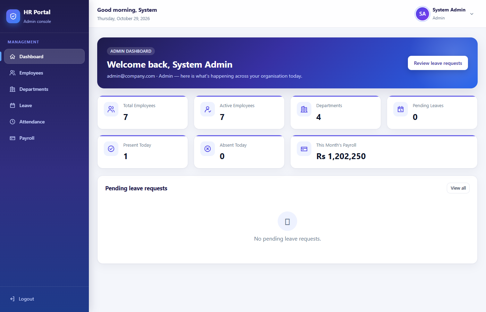
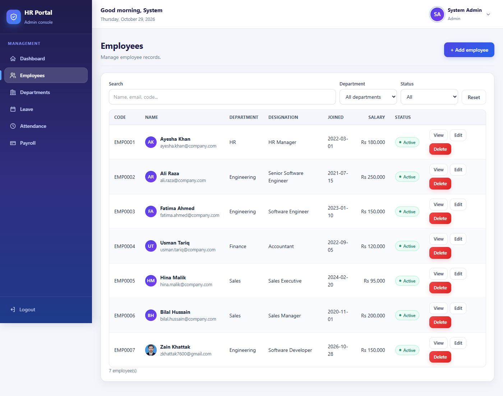
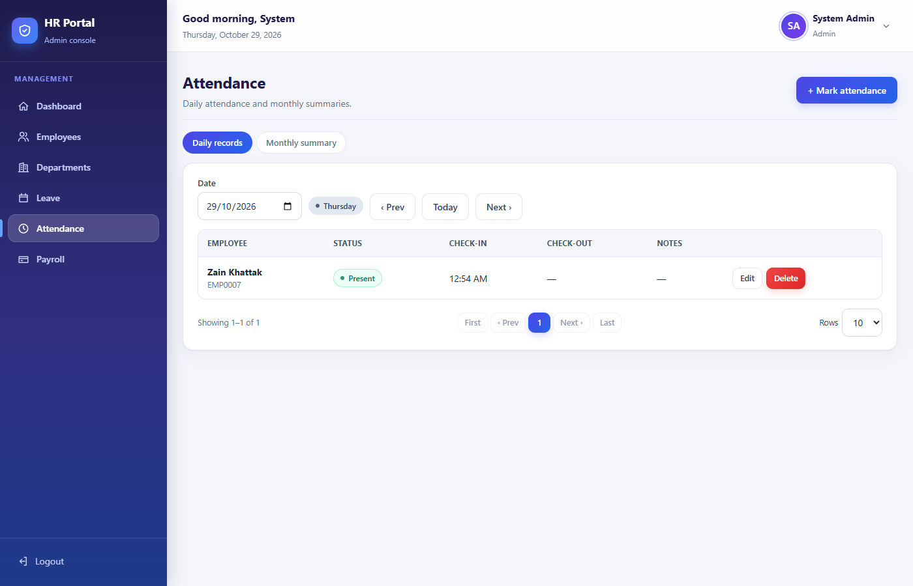
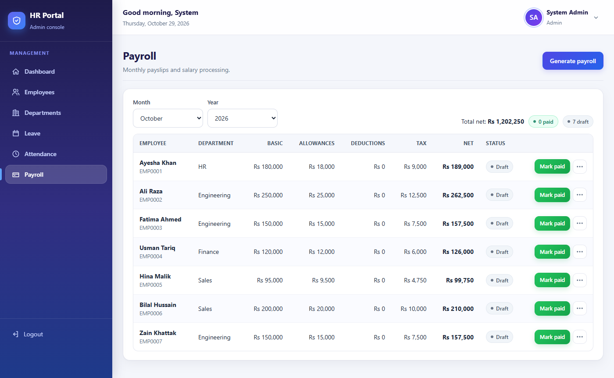
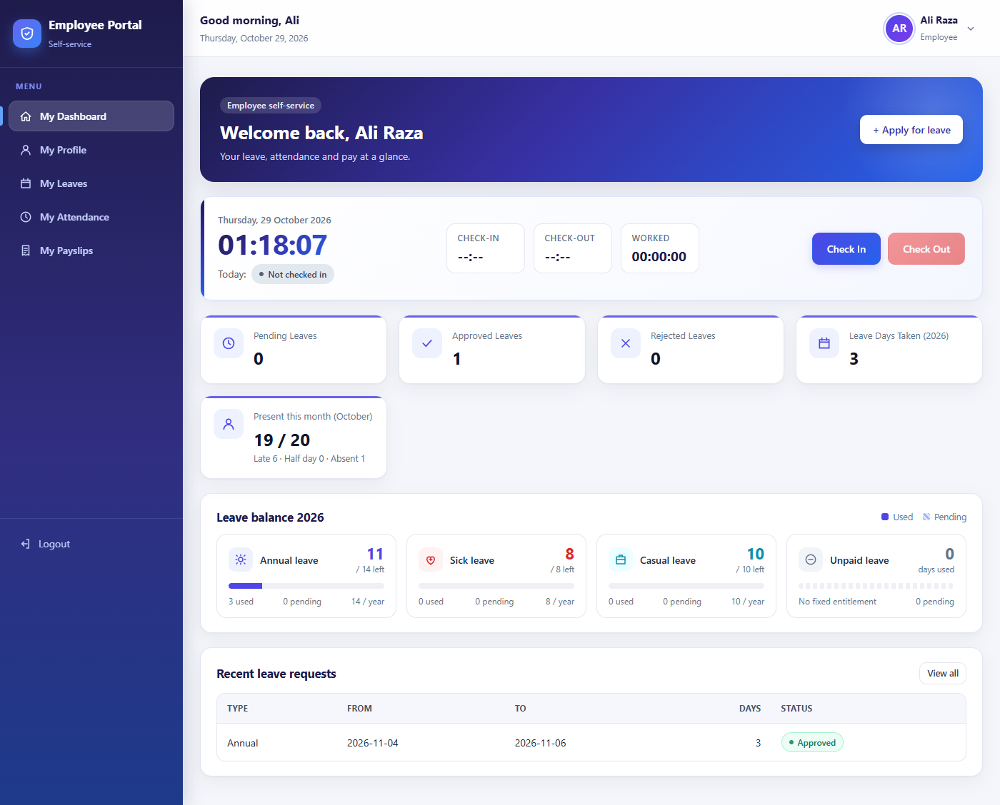
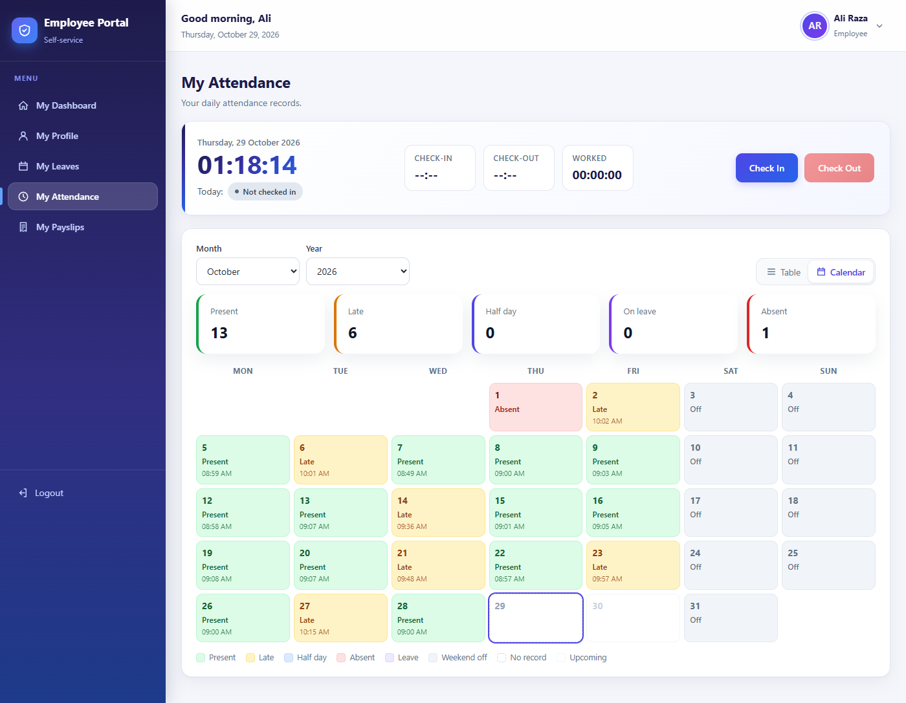
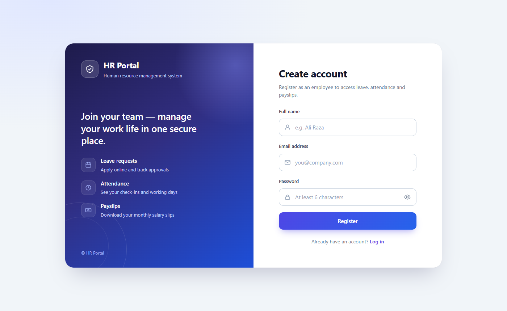

# HR Portal — Angular Frontend

> A modern, responsive **HR & Employee Leave Management** web app built with Angular 18 (standalone components, signals, SSR) and Tailwind CSS v4.


Backend API: **[hr-portal-api](https://github.com/zkhattak7600/hr-portal-api)** (ASP.NET Core 8 + EF Core + SQLite)

---

## Features

### Authentication
- JWT-based login and registration with form validation
- Forgot-password flow with reset code
- Route guards and an HTTP interceptor that attaches the token

### Admin portal
- **Dashboard** — headcount, leave and attendance overview
- **Employees** — paginated list with kebab (⋮) action menus, add / edit / delete
- **Departments** — manage organisational units
- **Leave approvals** — approve or reject employee leave requests
- **Attendance** — daily records with day names, weekends marked *Off*, 12-hour times
- **Payroll** — generate and view payslips

### Employee self-service portal
- Personal dashboard
- Leave balance cards (annual, sick, casual, unpaid) and *My Leaves* history
- Attendance as a table **and** a monthly calendar
- Payslips with print / save as PDF
- Profile photo upload

### UI / UX
- Fully responsive layout (desktop and mobile)
- Server-side rendering (Angular SSR) for fast first paint
- Clean Tailwind CSS v4 design

## Screenshots

| Admin dashboard | Employees |
|---|---|
|  |  |
| **Attendance** | **Payroll** |
|  |  |
| **Employee dashboard** | **Attendance calendar** |
|  |  |
| **Register** | |
|  | |

## Tech stack

| Layer | Technology |
|---|---|
| Framework | Angular 18 (standalone components, signals, new control flow) |
| Language | TypeScript |
| Styling | Tailwind CSS v4 |
| Rendering | Angular SSR (Express) |
| State / async | Angular Signals, RxJS |
| Backend | ASP.NET Core 8 Web API — [hr-portal-api](https://github.com/zkhattak7600/hr-portal-api) |

## Getting started

### Prerequisites
- Node.js 18+ and npm
- Angular CLI 18 (`npm i -g @angular/cli@18`)
- The backend API running locally — see [hr-portal-api](https://github.com/zkhattak7600/hr-portal-api)

### Run
```bash
git clone https://github.com/zkhattak7600/hr-portal-angular.git
cd hr-portal-angular
npm install
ng serve
```
Open <http://localhost:4200>. The app expects the API at `http://localhost:5000` (configured in `src/environments/environment.ts`).

### Build
```bash
ng build
```

## Project structure

```
src/
├── app/
│   ├── core/            # guards, interceptors, models, services, utils
│   ├── layout/          # admin shell (sidebar, header)
│   ├── employee-layout/ # employee self-service shell
│   ├── pages/           # login, register, forgot-password, dashboard,
│   │                    # employees, departments, leaves, attendance,
│   │                    # payroll, employee/*
│   └── shared/          # reusable UI components
├── environments/
└── styles.css
server.ts                # SSR server
```

## Author

**Zain Khattak** — Frontend Developer (Angular & TypeScript)
GitHub: [@zkhattak7600](https://github.com/zkhattak7600)

## Deployment (self-hosting)
The production build (`npm run build`) uses `src/environments/environment.prod.ts` (API URL + demo mode) and is can be self-hosted as a static SPA (e.g. on Vercel).
`vercel.json` sets the output directory to `dist/employee-leave-management/browser` and rewrites all routes to `index.csr.html`.
Local development (`ng serve`) keeps using `environment.ts` → `http://localhost:5000/api` with demo mode off.
